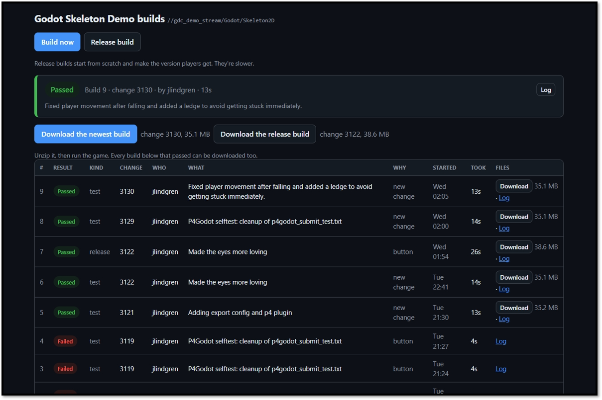
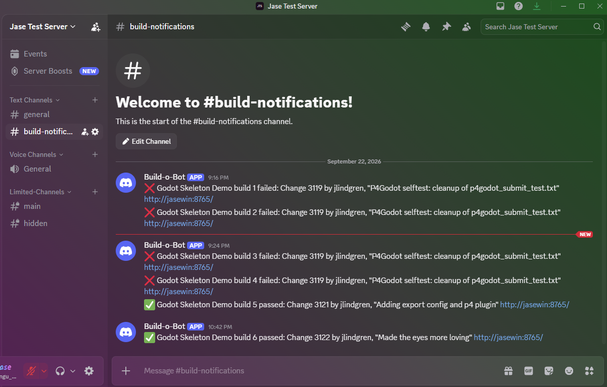

# P4 Build Machine Lite

[English](README.md) · [日本語](README.ja.md) · 简体中文

把一台闲置的电脑变成团队的构建机。有人向 P4 提交后，它会自动构建游戏，并把结果放到一个网页上，供团队成员下载。

适合独立团队、个人开发者和 Game Jam：用不上 Jenkins、TeamCity 或 Horde，但又想要自动构建。整个工具只有一个 exe 或一个 Python 文件。



## 说明

这个工具刚刚发布，目前只做过很少的测试。我打算近期录几个教程视频。有意见或问题请在 Issues 里留言，我会尽快回复。

## 安装

你需要一台能构建你的游戏的电脑，并装好 p4 命令行（P4 CLI，可在 perforce.com 下载）。

1. **把构建脚本加到你的项目里**。把示例文件夹里的所有文件复制到项目的顶层文件夹（也就是放着 `project.godot`、`Assets` 或 `.uproject` 的那个文件夹），然后提交：[Godot](examples/godot) · [Unity](examples/unity) · [Unreal](examples/unreal)。`build.bat`（Windows）和 `build.sh`（macOS、Linux）两个都留着，这样不管构建机是哪种系统都能构建。
2. **下载构建机程序**（[Windows、macOS 或 Linux 版](../../releases/latest)）并解压。Mac 版只支持 Apple 芯片。（如果装了 Python 3.9+，也可以直接用本仓库里的 `build_machine.py`。）
3. 在构建用的电脑上**启动它**：双击 `build-machine`（Linux 上运行 `./build-machine`），或者运行 `py build_machine.py`（Windows）或 `python3 build_machine.py`（macOS、Linux）。它没有签名，所以第一次运行时，Windows 可能会提示“Windows 已保护你的电脑”（点击**更多信息**，再点击**仍要运行**），macOS 可能会拒绝打开它（在“系统设置 › 隐私与安全性”里点击**仍要打开**）。如果 Windows 询问，请允许它通过防火墙，专用网络和公用网络都要允许，这样队友才能访问它。
4. 第一次运行时，它会生成一个 ini 文件，然后退出。**填写 `build-machine.ini`**（在 Windows 和 macOS 上它会自动打开）：设置 `stream`；如果项目在流的某个子文件夹里，再设置 `project_folder`。如果 p4 命令行还没配置好服务器，把 `server` 和 `user` 也填上。然后重新启动它：它只在启动时读取这个文件。
5. **打开它显示的团队链接**，并且只分享给你的团队：任何拿到链接的人都能启动构建。

如果 P4 需要你信任服务器或登录，构建机会在它的窗口里询问你。第一次构建会在一分钟内开始。

## 使用

- **顶部的面板**显示当前状态：构建中、通过，还是失败。它会自动刷新，把页面开着就行。
- **构建会自动开始**，每次提交后一分钟内启动。
- **立即构建**：马上构建最新变更。
- **发布构建**：从头构建，生成最终给玩家的版本。速度会慢一些。
- **下载**：下载任意一次通过的构建。顶部的链接（`/latest`）始终指向最新的那个。
- 右上角的 **English · 日本語 · 中文** 用来切换页面语言。默认使用浏览器的语言。构建机自己的窗口、设置文件和 Discord 消息都是英文的。

任何能访问这个页面的人都可以查看和下载。启动构建则需要团队链接，或者链接里包含的令牌。

## 试玩构建

把下面这段发给你的团队：

1. 在构建机的页面上点击**下载**。
2. 解压（在 Windows 上，右键 › **全部解压缩**）。不要直接在 zip 里运行游戏。
3. 运行游戏：Windows 上是 `.exe`，Mac 上是 `.app`。
4. 如果 Windows 提示“Windows 已保护你的电脑”，点击**更多信息**，再点击**仍要运行**。如果 macOS 不让打开，在“系统设置 › 隐私与安全性”里点击**仍要打开**。这只是因为游戏没有签名。

## 构建脚本

构建机会在脚本所在的文件夹里运行 `build.bat`（Windows）或 `build.sh`（macOS、Linux），并设置好这些环境变量：

| | |
|---|---|
| `BUILD_OUTPUT` | 一个空文件夹。你放进去的东西就是下载的内容。 |
| `BUILD_KIND` | `test` 或 `release` |
| `BUILD_CHANGE` | 正在构建的变更列表 |
| `BUILD_NUMBER` | 构建的编号 |

`build-machine.ini` 里全大写的设置，比如 `GODOT = C:\Godot\godot.exe`，也会作为环境变量一并传给脚本。

脚本退出码为 `0` 表示通过。Godot 和 Unity 的示例还会把游戏运行几秒钟，如果游戏崩溃或在日志里报错，就算失败：因为就算游戏一启动就崩，这两个引擎导出时也照样报告成功。

每次构建前，工作区都会被重置成和 P4 一致，只保留你的 depot 里 `.p4ignore` 列出的内容。如果它列出了引擎的缓存文件夹（`.godot/`、`Library/`、`Intermediate/`），测试构建就能一直很快。发布构建会把这些也删掉，连同所有不在 P4 里的东西，所以不要在构建机的 `workspace` 文件夹里存放或链接任何东西。

## 进阶用法

下文中，`BUILD-PC` 是从 P4 服务器那边访问构建机要用的地址，`TOKEN` 是构建机启动时显示的令牌。

### 一提交就构建

以 P4 super 用户身份，把这一行加到 `p4 triggers` 里：

```
	buildmachine change-commit //MyGame/main/... "curl -s -m 5 -d reason=p4-trigger -d token=TOKEN http://BUILD-PC:8765/build"
```

之后提交的人会在 `Change N submitted` 后面看到 `Build queued`（构建已排队）。如果构建机没开，他们会看到 `'buildmachine' validation failed`，但提交仍然会成功。

### 在 P4 Code Review 里测试每个评审

1. 在 `build-machine.ini` 里设置 `code_review_url`，比如 `http://localhost:8080`。
2. 确保 Code Review 里有一个项目（project），它的某个分支（branch）覆盖了你的流，比如 `//MyGame/main/...`。没有的话，流上的搁置不会变成评审。
3. 给一个工作流（workflow）添加一个测试（test），URL 填 `http://BUILD-PC:8765/build`，body 填下面这段，编码选 URL encoded：`change={change}&status={status}&update={update}&token=TOKEN`

每个评审都会在合并最新代码之后构建，并显示通过或失败，附带日志链接。锁定（`+l`）的文件也能取消搁置，即使作者还签出着它们（已在 P4 2026.1 上测试）。如果你的服务器拒绝，作者就得在搁置之后还原这些文件。“There was no response” 表示 Code Review 连不上 `BUILD-PC`。

### 同时在 Windows 和 Mac 上构建

两台机器上各运行一个构建机，使用相同的 `stream` 和 `project_folder`，再各自设置一个 `name`，比如 `MyGame (Mac)`，这样页面、zip 和 Discord 消息都能分清谁是谁。每个构建机都有自己的工作区、页面和令牌，并用各自的脚本构建每一次提交。要想一提交就构建，给每个构建机单独加一行触发器，名字要不同，比如 `buildmachine-win` 和 `buildmachine-mac`：两行同名时，P4 只会运行第一行。要用 Code Review，就给每个构建机各加一个测试。

### 容器里的 P4

适用于 [p4-server-docker](https://github.com/jase-perf/p4-server-docker) 及类似方案：

- **Docker Desktop**：用 `host.docker.internal` 作为 `BUILD-PC`。
- **Windows 上的 Podman**：容器访问不到构建机，所以跳过触发器和 Code Review 测试。构建仍然会自动开始。

不要同时运行 Docker Desktop 和 Podman。

### Discord

在 `build-machine.ini` 里设置 `discord_webhook`，每次通过或失败都会发到一个频道。



## 值得了解

- **P4 登录会过期**，默认是 12 小时。页面显示 P4 密码问题时，重启构建机程序，并在它的窗口里登录。如果 Game Jam 时间比较长，把它的用户加到一个 `Timeout` 更长的 P4 用户组里。
- **Godot**：在构建用的电脑上安装导出模板，并提交 `export_presets.cfg` 和你的 `.uid` 文件。如果 `godot` 不在 PATH 里（Mac 上是不在“应用程序”里），在 `build-machine.ini` 里把 `GODOT` 设置为你的 Godot 程序；在 Windows 上，用 `_console.exe` 那个。
- **Unity**：用 Unity Hub 把项目对应的 Unity 版本安装到默认文件夹，并登录（Personal 就可以）：脚本会在那里找到它。否则在 `build-machine.ini` 里设置 `UNITY`。把 `BuildScript.cs` 留在 `Assets/Editor` 里，并提交 `.meta` 文件。
- **Unreal**：在 Windows 上，脚本能找到通过 Epic Games Launcher 安装的引擎和已注册的源码版引擎；在 Mac 上，只能找到通过启动器安装的引擎。否则在 `build-machine.ini` 里设置 `UE_ROOT`。C++ 项目需要 Visual Studio（Windows），Mac 上构建需要 Xcode。发布构建打的是 Shipping 包，所以里面的游戏是 `UnrealGame-Win64-Shipping.exe`，而不是 `UnrealGame.exe`。

## 限制

一台电脑，一个流，一次只跑一个构建。它保留最近 20 次构建（`keep_builds`），外加每种类型里最新的一次成功构建。它不是系统服务：电脑重启后，需要再手动启动它。

等它不够用了，用 P4 的团队通常会换成 TeamCity（免费版包含 3 个构建代理）、装了 P4 插件的 Jenkins，或者面向 Unreal 的 Horde。你的构建脚本可以直接沿用。

## 安全

- 任何能访问这个页面的人都可以查看和下载构建。在公共 Wi-Fi 上，这也包括其他团队。
- 启动构建需要令牌。和页面一样，令牌也是通过明文 HTTP 传输的。
- 浏览器会把团队链接的 cookie 发给构建用的电脑上的每一个 Web 服务器，不管端口是多少，所以那台电脑上的其他服务器也能读到令牌。
- 如果令牌泄露了，删除 `token.txt` 并重启，然后更新触发器和 Code Review 测试。
- 任何能提交的人都能修改构建脚本，而构建机会运行它。

## 已验证的环境

Windows 11、Python 3.13、Godot 4.7.2、Unity 6000.3、Unreal 5.7、P4 2025.x 和 2026.1，以及 P4 Code Review 2026.3。Godot 和 Unity 通过构建机完整跑通了全流程；Unity 和 Unreal 的发布构建是手动运行的。Godot 的 `build.sh` 在 Ubuntu 上运行过，Linux 版构建机也是在那里构建并启动的。尚未测试：macOS 上的一切（各个 `build.sh` 脚本里的 Mac 部分，以及 Mac 版构建机）、Unity 和 Unreal 的 `build.sh` 脚本，以及 Discord。

## 许可证

MIT。见 [LICENSE](LICENSE)。
